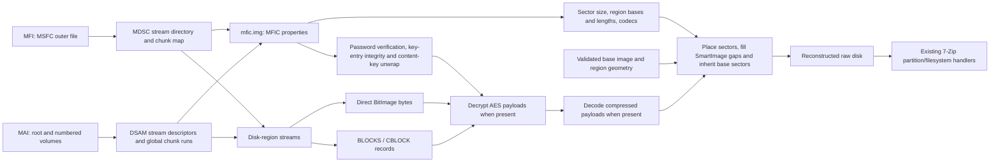

# Observed Miray MFI/MAI structures

Structures observed in known-content FullImage, SmartImage, BitImage, differential and overlay files
created with HDClone.
All integers are little endian. Unresolved fields are marked in the tables.
These notes are based on test images rather than a vendor specification.

The on-disk encodings below were determined from local fixtures.



## MFI outer MSFC header

| Offset | Width | Observed role |
|---|---:|---|
| `0x00` | 20 | Signature `4d53464361115bc7b1f67a4a92fbacd373713e06` |
| `0x14` | 4 | Version, observed 1 |
| `0x18` | 4 | Data-region file offset, observed 65536 |
| `0x1c` | 8 | Data-region length |
| `0x24` | 16 | Identifier |
| `0x34` | 8 | Total container data length in the first segment; zero in continuation segments |
| `0x3c` | 4 | Segment count in the first segment |
| `0x44` | 8 | Split size; zero in observed unsplit files |
| `0x4c` | 8 | Zero-based segment index |
| `0x54` | 8 | Segment data offset in the reassembled container |
| `0x6c` | 4 | CRC32 of bytes `[0, 0x6c)` |

The reader supports single files and numbered `<stem>.001.mfi`,
`<stem>.002.mfis`, ... segment sets. Each continuation has its own MSFC header;
these headers are removed when joining the data ranges. IDs, CRCs, sequence
numbers, lengths and offsets must agree. Missing or mismatched volumes fail.
The current resource limit is 1024 segments. A file extension alone is not
sufficient for recognition. MAI volumes use a separate layout described below.

## MDSC stream directory

MDSC starts at the MSFC data offset. Its 80-byte header includes:

| Offset | Width | Observed role |
|---|---:|---|
| `0x00` | 4 | `MDSC` |
| `0x04` | 4 | Header size, 80 |
| `0x08` | 16 | Format identifier |
| `0x18` | 4 | Version, 1 |
| `0x1c` | 16 | Image/container identifier |
| `0x3c` | 8 | Chunk size, 1 MiB in fixtures |
| `0x44` | 4 | Number of physical chunks |
| `0x48` | 4 | First directory-entry offset relative to MDSC |
| `0x4c` | 4 | CRC32 of the logical `Stream0` bytes, with this field replaced by zero |

The first chunk contains the bootstrap entry and mapping for `Stream0`. The
logical directory can span noncontiguous chunks; entry and extra-record offsets
address that logical stream. A 60-byte stream entry has next-entry
offset at `+0`, record size at `+4`, kind at `+8`, stream ID at `+12`, logical
length at `+16`, a 32-byte name at `+24`, and an extent-list pointer at `+56`.

Kind 2 uses extent lists of linked records: next pointer `u32`, record size `u32`, then
physical chunk indices `u32[]`. Only `ceil(stream_length / chunk_size)` indices
are needed; list capacity can exceed that count. Chunk `i` is located at
`MSFC.data_offset + i * chunk_size`. Stream lengths exclude trailing slot padding.
`Stream0` refers to the internal directory data. `mfic.img` contains image
metadata; other names identify disk-region streams and their `.ix` indices.
The directory checksum covers the logical `Stream0` length, including its
header and extent records. Unused bytes after that length are excluded.
Both readers validate this checksum before interpreting image metadata.

Kind 0 stores inline data in the directory at the entry's extra-record offset
plus eight bytes. The first extra word is zero; the second is not a record
length. Inline data can cross directory chunk boundaries and is included in
the directory CRC. The 7-Zip reader resolves these bytes through `Stream0`'s
mapping. Directory and payload offsets use checked 64-bit arithmetic.

## MAI outer archive container

The observed initial magic is **`HSAM`**, rather than `MAI` or `MASC`. A matching
**`FSAM`** footer occupies the last 4096 bytes. Both contain version 1 and matching
identifiers. Their CRC32 is computed over the complete record with bytes 8–11
replaced by zero.

Header fields: record size `u32@4=4096`, CRC `u32@8`, version `u32@12`, identifier
at 16, physical chunk size `u32@44`, header size `u32@48`, and footer size
`u32@52`. The fixtures use 1 MiB chunks.

The footer has descriptor offset `u64@56` and descriptor length `u64@64`. Its
field at 52 is the actual chunk count, while the header's field at 52 is the
footer size. Additional descriptor flags remain unresolved.

The descriptor begins with `DSAM`, total byte length `u32@4`, CRC `u32@8`,
state `u32@12`, stream-table offset `u32@16` and stream-table length `u32@20`.
State 1 occurs in the final root descriptor; state 2 also occurs in an earlier
segment's descriptor. CRC32 covers the full descriptor with its CRC field
zeroed. The stream table starts with a `u32` count followed by 72-byte entries:

| Entry offset | Width | Role |
|---|---:|---|
| `0` | 32 | Name |
| `32` | 4 | Stream kind: 0 empty, 1 inline, 2 chunk-backed |
| `36` | 4 | Flags/state; values 0, 3 and 4 observed |
| `40` | 8 | Logical stream length |
| `48` | 4 | Inline-data offset relative to descriptor |
| `52` | 4 | Inline-data length |
| `56` | 4 | Extent-run table offset relative to descriptor |
| `60` | 4 | Extent-run table byte length |
| `64` | 4 | Stream checksum-list offset relative to descriptor |
| `68` | 4 | Stream checksum-list byte length |

Small metadata/index streams can be entirely inline. Other streams use pairs
of `u32 first_chunk, u32 number_of_chunks`. Their physical byte range begins at
`header_size + first_chunk * chunk_size`. The prototype rejects mixed
inline/extent layouts that do not match the observed structures.

Native empty streams use kind 0 with zero logical size and zero inline, extent
and checksum offsets/lengths. Empty differential index streams use this form.

### Segmented MAI

The root `<stem>.mai` is the final volume, with `HSAM`/`FSAM` records. Earlier
volumes are `<stem>.001.mais`, `<stem>.002.mais`, and so on, with `XSAM`/`NSAM`
records. The reader accepts numbering widths from one to six digits and limits
the complete set to 1024 files.

Header offset 32 is the one-based volume ordinal, offset 36 is its first global
chunk index, and offset 40 is the selected maximum number of chunks per volume.
Footer offset 52 gives the volume's actual chunk count. Each file has a 4096-byte
header, that number of complete chunks, and a 4096-byte footer. Descriptor
positions in footers are local file offsets. Stream extent runs use global
chunk indices; chunk `c` is at `4096 + (c - first_chunk) * chunk_size` in the
containing volume. Descriptor chunks contribute to the global chunk numbering.

The final descriptor has a volume-table offset at 24 and length at 28. This
table contains a `u32` count and 16-byte records for the preceding volumes:
`u32 first_chunk, chunk_count, checksum_offset, checksum_length`. The readers
validate these ranges against the opened volume headers and footers. Missing
volumes, inconsistent identifiers, sequence numbers, sizes or CRCs fail.

The observed writer requires a split size of at least 100 MiB. Smaller test
sizes fail before image creation. For a selected size `s`, the header's chunk
limit is `floor((s - 8192) / chunk_size)`; both readers compare this with MFIC
property 15. An image that fits into one file can still retain a selected split
size and chunk limit.

### MAI stream checksums

A checksum list contains `u16 digest_length, u16 type, digest[digest_length]`
records and a four-byte zero terminator. Observed type definitions are 2=MD5,
3=SHA-1, 4=SHA-256 and 6=SHA3-256, with digest lengths 16, 20, 32 and 32.
Both readers check supported stream digests over the stream's stored bytes,
including block headers and encrypted payloads. Verification uses bounded
buffers and requires a complete pass over every stream that has a digest.
Truncated, duplicate, malformed or unsupported digest records are rejected.

The volume table uses the same digest-list encoding for physical segments.
Those digests cover the entire physical file: header, all chunks and padding,
descriptor, and footer. The final metadata volume has no self-digest. Native
file-information results confirm the association between these records and
complete segment files. Both readers validate all supported stored digests.

Digest-bearing fixtures are derived from native images. The native reader opens
the physical-digest fixture and reports values matching complete-file hashes.
Structural CRCs, content digests and fixed-key integrity trailers do not establish
producer identity or certify that every archival authentication mechanism has
been identified.

## Shared MFIC metadata

`mfic.img` begins with `MFIC`, version 2, 3 or 4 at offset 4, and an observed zero
at 8. Values at 12, 16 and 20 are respectively `7` or `0x80000007`, `4`, and `1`
in the accepted fixtures, including encrypted images. Their complete semantics remain open.

From offset 24, properties are `u32 key, u32 byte_length, byte value[length]`.
Some version-3 keys have bit 31 set. The readers normalize the observed keys
to the lower 31 bits; the full compatibility/mandatory-field meaning of that
bit needs further investigation.

Global properties include:

| Key | Observed value |
|---|---|
| `0` | Image filename |
| `1` | Creator name |
| `2` | Creator/version description |
| `4` | Seven-byte creation date/time |
| `6` | Logical sector size, 512 or 4096 |
| `8` | 32-byte password verifier, when protected |
| `9` | 32-byte password salt, when protected |
| `11` | Encryption: 0=none, 1=AES-128, 2=AES-256 |
| `12` | Total disk sector count |
| `13` | Image identifier, 16 bytes |
| `14` | Base-image identifier for differential images, 16 bytes |
| `15` | Split size; all ones in unsplit files, 2 MiB in the split fixture |
| `17` | Image type: MFI full=8, Smart=9, direct BitImage=10, differential=14, framed BitImage=20; MAI full=24, Smart=25, BitImage=28; MAI differentials also use 14 |
| `19`, `20`, `21` | Source device name, serial, firmware |
| `26` | Recorded UTF-8 base-image filename or path for differential images |
| `0x2000` | Serialized key store and additional partition information |

A **zero-length key 5 starts a disk-region descriptor**. It can repeat. Within
each descriptor:

| Key | Observed value |
|---|---|
| `0x1000` | Container stream name |
| `0x1001` | Region base LBA in reconstructed disk |
| `0x1002` | Stored stream byte length |
| `0x1003` | Number of sectors actually stored in this region |
| `0x1004` | Highest stored region-relative sector index |
| `0x1007` | Region type; 1=filesystem, 2=partition table, 3=gap, 4=direct disk data, 5=framed whole disk, 8=differential region |
| `0x100a` | Logical region length in sectors, including omitted sectors |
| `0x100b` | Compression enum: 0=none, 1=zlib, 2=LZ4, 3=LZMA1 |
| `0x100c` | Codec properties; five LZMA1 bytes observed |
| `0x1008` | Additional region metadata, empty in initial fixtures |

The tested full-image regions cover the whole disk consecutively. A simple
MBR/ext4 disk produced three streams: MBR sector 0, gap sectors 1–2047, and the
filesystem starting at sector 2048. Treating the metadata as one flat map loses
these repeated descriptor keys and cannot reconstruct ordinary partitioned
images correctly.

The sum of block sector counts equals `0x1003`; block addresses range within
`0x100a`. The final stored sector agrees with `0x1004`. These values differ in
SmartImages because unused sectors are omitted.

Self-contained SmartImages (types 9/25) can have holes before,
between, or after stored blocks, and outside described regions. The readers
expose omitted sectors as zero. Those bytes are a canonical representation for
filesystem access; their original contents were not archived and cannot be
recovered from this image. Full-image types still require complete coverage.
Differential images inherit absent sectors from a validated base image, as described below.

Key 15 contains the selected split size and must match MSFC offset `0x44` for split MFI sets. Native differentials use zero, including split MAI differentials.

The direct MFI BitImage (type 10, region kind 4) stores an exact disk byte stream
named `data`, without BLOCKS headers. Framed BitImages use the block records
below and a whole-disk region (kind 5). All these full-image forms require
complete disk coverage. A BitImage sample decodes to 8,068,792,320
bytes; both independent readers produce matching output hashes.

## Passwords and encryption

Password protection alone has encryption enum 0 and leaves sector data
unencrypted. The readers still require and verify the password before exposing
disk contents. AES-128/256 leave directory, metadata and block headers readable;
the sector payloads are encrypted.

The observed derivation uses UTF-8 password bytes without normalization:

```
H0       = SHA256(UTF8(password))
Kp       = SHA256(salt || H0)
verifier = SHA256(salt || Kp)
```

The calculated verifier must match global property 8. Property 9 contains the salt.

The content key is a separate random 16- or 32-byte key, stored wrapped in the
`KSTO` chunk of property `0x2000`. The initial word counts additional chunks:
the encrypted BitImage fixtures have one (`KSTO`); logical images have two
(`KSTO` and `PRTD`). Chunks have a four-byte tag and a `u32` payload length.
The readers find `KSTO` independently of chunk order and validate every chunk's
bounds. For the observed single-entry key store:

| Property-relative offset | Width | Meaning |
|---|---:|---|
| 4 | 4 | `KSTO` |
| 8 | 4 | Chunk payload length; chunk ends at `12 + length` |
| 12 | 4 | Key-store version 1 |
| 16 | 4 | Entry count; bounded to 4096 |
| 20 | 4 | Entry byte length |
| 24 | 4 | Entry header size 40 |
| 32 | 4 | Image-format wrapping key slot 5 or 9 |
| 36 | 4 | Wrapping mode 5 for encrypted payloads, 0 otherwise |
| 40 | 4 | Content key length, 0, 16 or 32 |
| 44 | 4 | Password verification mode 2 when protected, 0 otherwise |
| 56 | 4 | Creator label length |
| 60 | 16/32 | Wrapped content key |

The wrapped bytes are decrypted first with AES-256 ECB using `Kp`, then with
AES-256 ECB using the selected fixed image-format wrapping slot. Its first 32 bytes
are the wrapping constant used by both readers. The password-derived key
removes the outer wrapping layer.

Sector payloads use independent AES ECB blocks with the recovered content key.
Compressed payloads include zero padding to a 16-byte boundary; codec termination
determines the useful compressed length, and at most 15 trailing zero bytes
are accepted. Raw sector payloads are already aligned. Decryption precedes
decompression.

Each supported key entry ends with a 32-byte integrity trailer. Its input is the
concatenation of serialized per-region property records, including region
attachments in property `0x2000`, followed by the complete key entry except its
trailer. Ordinary region fields use keys `0x1000` through `0x1fff`.
Property records retain their original tag, including bit 31, length and payload.
The zero-length region marker and global properties are excluded.

```
D       = SHA256(region_property_records || key_entry_without_trailer)
trailer = AES256_ECB_ENCRYPT(selected_wrapping_constant, D)
```

The readers decrypt the trailer and compare the digest before using an entry.
This check also applies to unencrypted entries with no content key. The input
scope was confirmed by native hash-call observations and all native fixtures
with supported entries match. Modified trailers, creator labels or authenticated
region properties fail. The fixed wrapping constants identify format encodings;
this integrity mechanism is not a secret-key proof of producer identity.
Version-1 stores can contain multiple variable-length entries. The readers select
entries using the supported slot, wrapping mode and password method; all usable
entries must unwrap to the same content key. Other recipient entries can coexist
with a supported entry. Stores with no supported entry, conflicting keys, other
store versions, or malformed lengths are rejected. Multiple-entry and reordered
chunk tests use derived fixtures; the native fixtures use single-entry stores.

A 3,310,419,968-byte MFI describes a 1,000,204,886,016-byte disk with
three region streams. The logical partition map contains FAT32 and Linux
partitions, plus an unallocated tail. It contains 13,634 stored blocks and
29,418,917 stored sectors. Native random access fills holes on demand, without
materializing a 1 TB output. Python raw export seeks over those holes and
truncates to the declared disk size; physical sparse-file support depends on
the output filesystem.

## Differential images

Native `.mfd` images use MFIC version 4, image type 14 and region kind 8. Either
MFI or MAI can provide the outer container. Their BLOCKS/CBLOCK streams store
changed sectors; all gaps inherit bytes from the referenced base. Empty change
streams contain only a terminal record. Unused SmartImage sectors in a base
retain the base reader's canonical zero representation.

Global properties 13 and 14 link the child and base identifiers. Property 26
records the base path. Readers use its sibling basename, validate the expected
identifier, sector size, logical disk size and region layout, and open the base
read-only. Absolute recorded paths do not direct reads outside the image's
directory. Missing bases, inconsistent identities and incompatible layouts fail.
Chains are limited to 16 images, including the final base; cycles are rejected
or reach that bound. Required passwords must also unlock the bases.

Split MFI differentials start with `<stem>.001.mfd` and continue with numbered
`.mfds` volumes. Split MAI differentials retain the `.mfd` metadata root and
numbered `.mais` volumes. Their split-size property can be zero while the physical volume header
retains a chunk limit. Numbered base-image volumes remain alongside the child.

Native fixtures cover MFI, MAI, AES-128, AES-256, SmartImage, unchanged disks and
segmented MAI. Both readers reconstruct the expected complete source contents.

## Disk data blocks

Disk-region streams contain framed records. Native rescue retry records can be
stored out of LBA order; the reader sorts their locations and checks overlap
and coverage before exposing logical data. The disk LBA is the sum of
the region-relative record LBA and the MFIC region base.

Uncompressed record:

```
12 bytes  "BLOCKS0.0.01"
u64       region-relative start LBA
u16       header checksum
u32       sector count
bytes     sector_count * logical_sector_size data
```

The checksum is a 16-bit one's-complement word sum. The first 22 bytes,
including the stored checksum, fold to `0xffff`; the count is excluded.

Compressed record:

```
12 bytes  "CBLOCK1.0.00"
u64       region-relative start LBA
u16       header checksum
u32       uncompressed sector count
u32       block flags, observed zero
u32       packed byte count
bytes     compressed payload
```

Here the checksum covers the first **26** bytes, including the sector count.
The compression method comes from the region's MFIC properties. A region with
compression enabled may also contain `BLOCKS0.0.01` records for incompressible
data; those records contain literal sector bytes. A controlled native fixture
with both compressed and raw blocks verifies this fallback. QuickCompress
uses independent [LZ4 blocks](https://github.com/lz4/lz4/blob/dev/doc/lz4_Block_format.md),
Normal uses zlib-wrapped Deflate, and Strong uses raw LZMA1. The LZMA properties
encode `lc/lp/pb` in byte 0 and the dictionary size in the next four bytes.

A terminal record has start LBA `0xffffffffffffffff` and ends after 22 bytes.
The `.ix` companion streams contain observed pairs of `u64 stream_offset,
u64 start_LBA`; the prototype builds its own bounded index by scanning records.

## Source-error ranges

Per-region property `0x2000` can contain a chunk-count word and an `ELST` chunk.
The list payload is `u32 version=1, u32 count`, followed by pairs of
`u64 region_relative_sector, u64 sector_count`. Each range is positive, ordered,
nonoverlapping and contained within its region. A separate global `0x2000`
property still contains `KSTO`; the two scopes must not be conflated.

The complete serialized region attachment is included in the key-entry hash
prefix. Full-coverage layouts can omit records only where an error list accounts
for the missing source sectors. Direct BitImage can retain placeholder storage;
those bytes remain unavailable. Reads stop at an unavailable range and extraction
reports an error. Native direct MFI and AES-256/LZMA MAI fixtures identify one
unreadable source sector and preserve all surviving data. Other list types and
interrupted checkpoint layouts require further verification.

## External MFO overlays

An `.mfo` is an MFI container containing `meta.ovl`, `_overlay`, and the backing
stream named in the overlay header, normally `_overlayData`. The metadata uses
MFIC version 4, image type 21, one region of kind 9, and global property 14 for
the parent identifier. Its region base is all ones and its stored count is zero.
The declared logical geometry must match the selected parent.

The 132-byte `_overlay` header starts with `MSFF` and version `0x01000000`.

| Offset | Width | Role |
|---|---:|---|
| 8 | 32 | Backing stream name |
| 40 | 16 | Overlay identifier |
| 56 | 16 | Last-bound parent identifier; may be zero or stale |
| 72 | 8 | Capacity in bytes |
| 80 | 8 | Map capacity field |
| 88 | 8 | Logical disk size in bytes |
| 96 | 8 | Sector size |
| 104 | 8 | Sector count |
| 112 | 8 | Next free backing sector |
| 120 | 4 | Allocation unit in sectors |
| 124 | 6 | Hierarchy dimensions, followed by zeros |
| 130 | 1 | Index shift |
| 131 | 1 | Pointer width, 4 or 8 bytes |

For dimension `d`, a table has `d * sector_size / pointer_width` entries. There
are one to six levels. A leaf entry covers `allocation_unit * sector_size`
logical bytes. A higher entry covers the span of the next level multiplied by
that next level's entry count. The root table starts at backing offset zero.
Each pointer is an absolute backing-sector index. An all-ones pointer inherits
that logical range from the parent; zero is invalid. Leaf pointers select data
allocations. Aliased data pointers are accepted. Every table and allocation must
fit within the persisted backing range; arithmetic and traversal are bounded.

The parent is selected by property 26 when present, otherwise by sibling names
with MFI, MAI or MFD suffixes, including numbered MFI roots. Its metadata
identifier and geometry must match before its contents are used. The MSFF
last-bound field is informational: official restores accept empty and stale
values there. Parent password checks, decryption, segmentation, differential
inheritance and source-error reporting retain their normal semantics.

The reader supports plaintext overlay maps over protected or unprotected
parents. It does not modify the sidecar. Native empty overlays can retain zero
MSFC data lengths; modified fixtures finalize those lengths on close. The
zero-length exception is accepted only with valid overlay metadata and mappings.

Official full restores verify both pointer widths, all hierarchy depths, mixed
dimensions, shared data pointers, 512-byte and 4096-byte sectors, an MAI parent,
and a larger disk. All resulting logical bytes match the expected compositions.
Independent reader checks also cover encrypted, segmented and differential
parents. Interrupted overlay transactions and separately encrypted sidecar
encodings remain unverified.

## Evidence and limits

The baseline native-writer fixtures match their source contents in the Python and
7-Zip implementations. No constant file offsets are used for extraction: the
directory/descriptor mappings determine all payload locations. Twenty-five
malformed inputs exercise bounds, CRCs, cycles, and codec failures.

Three additional derived cases exercise leading/trailing holes, gaps between
regions, and gaps before a stored block in both readers, including sparse raw export. Native SmartImage fixtures
preserve the known filesystem and test-file contents; a supplied image
is also used for partition/FAT32 browsing checks, without publishing its
contents in the synthetic fixture bundle.

The ext4 sample's inode 31186 has a 12,288-byte indexed directory
whose last two extents point to blocks 244056253 and 244056401. Neither block
is represented in the archive's stored-block map, and its saved block allocation
bitmap marks both as free. These reads return canonical zeroes; 7-Zip's unchanged
ext4 handler rejects the zero directory records. Both independent readers agree
on the missing ranges. Resolving that inconsistency or replaying any pending
filesystem changes is separate from container decoding and remains unverified.

Additional native fixtures cover passwords, AES-128/AES-256 across all four
compression modes, SmartImage, BitImage, raw-block fallback, and split MFI.
The manifests and variant-verification reports record the tested combinations,
including writer failures. Three further native fixtures exercise segmented MFI
and MAI, including AES-256 MAI payloads and different numbering widths. Both
readers reconstruct their complete source disks with matching output.

Derived fixtures exercise multiple key entries, unrelated recipients, reordered
and additional chunks, all four MAI stream digests and complete physical segment digests. Further negative cases
cover missing or inconsistent MAI volumes, corrupt descriptors, conflicting keys,
incorrect digests and the MFI directory checksum. Correct, missing and wrong
passwords are tested.

A 143-case regression corpus passes with both the standalone executable and
DLL-backed command-line reader on a native Windows 11 x64 virtual machine.
Eleven File Manager checks in its interactive desktop session verify FullImage,
SmartImage and BitImage browsing, AES password prompts, Unicode passwords and
Unicode paths, including overlay browsing. Both command-line readers also extract the expected nested file
from those paths. The same corpus passes under Wine and on Linux with ASan/UBSan.
Test scripts and fixtures remain outside the contribution.

Interrupted checkpoint layouts, region-list types beyond `ELST`, other key-store
versions or wrapping methods, unknown mandatory properties and unobserved
producer layouts still require verification. Files without sufficient persisted metadata or complete stored
ranges are rejected. Missing sectors are never represented as verified data.
Existing 7-Zip handlers parse the reconstructed partitions and filesystems.

## Interoperability and provenance

The handler adds read-only support for HDClone `.mai`, `.mfi`, `.mfd` and `.mfo` disk images
to 7-Zip. Supported images can be opened, browsed and extracted without
HDClone installed. The implementation covers the layouts described above.

### Licensing

The new handler and documentation are contributed under the GNU Lesser General
Public License, version 2.1 or any later version, consistent with
[7-Zip's source license](https://github.com/ip7z/7zip/blob/b88c6bc09339de32f7d18bbab900686b244f42ba/DOC/License.txt).
They may be distributed as part of 7-Zip under those terms. The contribution
does not modify the existing unRAR- or BSD-licensed files or their license terms.

### Trademarks

HDClone and Miray are product and company names of
[Miray Software AG](https://www.miray.de/company/imprint/index.html). They are
used here to identify the supported formats and their producer. This contribution
is independent of Miray Software AG and is not affiliated with, endorsed by or
sponsored by the company.

### Development methods

- **Image observation.** Known-content disk images were generated with HDClone.
  Their container records, region maps and decoded bytes were compared with the
  source disks.
- **Binary inspection.** Image-container, password and key-wrapping routines
  were inspected to resolve format fields and cryptographic parameters.
- **Format description.** The observations were recorded as container layouts,
  field meanings, compression methods, checksums and password calculations.
- **Implementation.** The parser was implemented from those observations using
  existing 7-Zip codecs and cryptographic primitives. Vendor executables,
  runtime modules and code dumps are not included in the contribution.
- **Validation.** The native handler and a separate Python reader were compared
  against known source contents. Supplied images were also used for compatibility
  checks. Local validation fixtures contain generated test data rather
  than contents from the supplied images.

### Password-protected images

For supported protected images, the handler verifies the supplied password
before exposing the disk contents. Missing and incorrect passwords are rejected.

The implementation includes a fixed image-format key-wrapping constant recovered
during analysis. The password-derived key removes a separate wrapping layer
around the per-image content key. The fixed constant alone does not decrypt an
encrypted image. Password recovery and brute-force search are not implemented.

### Interoperability references

[Article 6 of Directive 2009/24/EC](https://eur-lex.europa.eu/legal-content/EN/TXT/?uri=CELEX%3A32009L0024)
and [Section 69e of the German Copyright Act](https://www.gesetze-im-internet.de/urhg/__69e.html)
address decompilation for interoperability subject to conditions concerning
authorization to use the program, necessity, scope and use of the information.

The U.S. Copyright Office discusses *Sega Enterprises Ltd. v. Accolade, Inc.*
and *Sony Computer Entertainment, Inc. v. Connectix Corp.* as examples of
interoperability-related fair use in its
[2015 notice on software-enabled consumer products](https://www.govinfo.gov/content/pkg/FR-2015-12-15/pdf/2015-31411.pdf#page=3).
These references describe the legal context; they do not establish that every
statutory or contractual condition is satisfied by this contribution.

### Scope

The handler reads existing images and extracts their contents. It does not
create, modify or write HDClone images, implement the cloning engine, or
implement Miray product licensing or activation.
